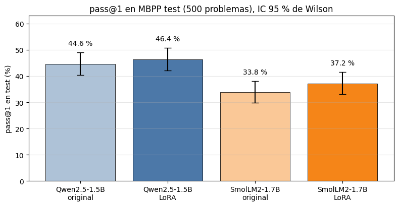
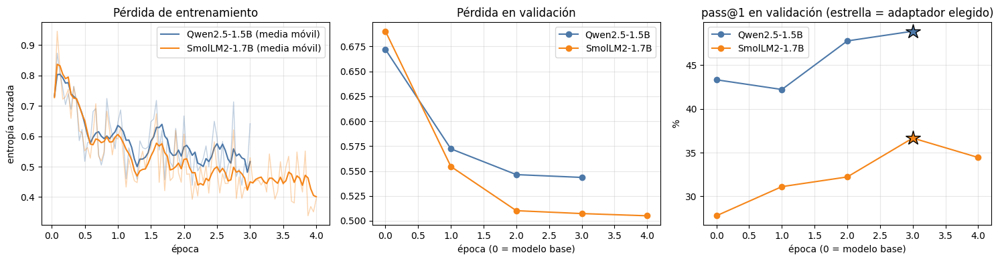

# MP3 - Cesar Leal

Notebook: `MP3_Equipo21.ipynb`. Lo corrí completo en Colab con una T4 (unos 45 min en total). Tiene las 11 secciones en el orden que pide el enunciado.

Zip para la entrega (notebook + los 2 adaptadores LoRA, 40 MB): https://drive.google.com/file/d/14gQnqqSzlMVdC4H23T3LT_E9u6sjTkJ6/view?usp=sharing

## Resultados

pass@1 sobre los 500 problemas de test, con greedy y la misma configuración de generación para los 4 casos:

| Configuración | pass@1 | Resueltos |
|---|---|---|
| Qwen2.5-1.5B zero-shot | 44,6 % | 223 |
| Qwen2.5-1.5B + LoRA | 46,4 % | 232 |
| SmolLM2-1.7B zero-shot | 33,8 % | 169 |
| SmolLM2-1.7B + LoRA | 37,2 % | 186 |



Qwen es mejor en las dos versiones. El finetuning mejora a los dos modelos, pero poco (+1,8 y +3,4 puntos), y con McNemar la diferencia no sale significativa. En el notebook está el análisis por tipo de error y algunos ejemplos de problemas que el finetuning arregla y otros que daña.

## Entrenamiento

LoRA con r=16 y alpha=32 sobre q/k/v/o_proj. Qwen con lr 1e-4 y 3 épocas, SmolLM2 con lr 2e-4 y 4 épocas. En cada época medí el pass@1 en validación y guardé el adaptador de la mejor época, que fue la 3 en los dos:

| | base | ép. 1 | ép. 2 | ép. 3 | ép. 4 |
|---|---|---|---|---|---|
| Qwen | 43,3 % | 42,2 % | 47,8 % | 48,9 % | - |
| SmolLM2 | 27,8 % | 31,1 % | 32,2 % | 36,7 % | 34,4 % |



La pérdida de validación bajó en todas las épocas, pero el pass@1 no: en SmolLM2 la época 4 fue peor que la 3. Por eso escogí la época con el pass@1 y no con la pérdida.

## Otras cosas

- En el prompt van los asserts del problema y al final se abre un bloque ```python. Así el modelo sabe cómo se llama la función, y los modelos base generan solo el código y cierran el bloque, que es también la condición de parada.
- Los asserts se ejecutan en un subproceso aparte con timeout, para que un bucle infinito o un `input()` no bloqueen el notebook. Antes de evaluar los modelos verifiqué que las 500 soluciones de referencia pasan.
- Los resultados y los adaptadores se guardan en Drive, así que si se cae Colab no hay que repetir todo.
