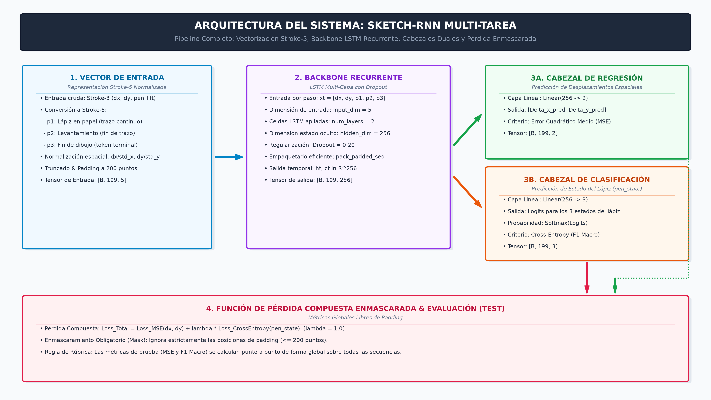

# Microproyecto 1 — Generación de Bocetos (Sketch-RNN)

## Maestría en Inteligencia Artificial (MAIA) — Universidad de los Andes
**Curso:** Modelos Avanzados de Procesamiento de Lenguaje Natural (MAPLN)  
**Equipo:** Equipo 21

### Integrantes
1. **Juan Javier Valera Mejias**
2. **Juan David Villalba Guavita**
3. **Juan Felipe Rodriguez Granados**
4. **Leidy Dayana Vega Medina**
5. **Cesar Steven Leal Perez**

---

## 1. Descripción del Proyecto

Este proyecto implementa una red neuronal recurrente autorregresiva de tipo **Sketch-RNN** en **PyTorch** para el modelado y generación de bocetos vectoriales a partir del dataset *Quick, Draw!* de Google Creative Lab, enfocado en la categoría **`cat` (gatos)**.

A diferencia del procesamiento de imágenes matriciales basadas en píxeles (CNNs), los dibujos vectoriales se tratan como **secuencias temporales multimodales** de desplazamientos biomecánicos y estados de lápiz.

---

## 2. Arquitectura del Modelo

El modelo implementa una arquitectura **Multi-Task Learning** basada en un **Backbone Recurrente LSTM con Cabezales Desacoplados**:

* **Entrada (Stroke-5):** Vector de 5 dimensiones $x_t = [\Delta x_{\text{norm}}, \Delta y_{\text{norm}}, p_1, p_2, p_3]$, donde las coordenadas espaciales se normalizan con la desviación estándar muestral de entrenamiento ($\sigma_x, \sigma_y$) y $[p_1, p_2, p_3]$ codifica el estado categórico del lápiz.
* **Backbone Recurrente:** 2 capas de LSTM apiladas (`hidden_dim=256`, `dropout=0.20`), con empaquetado dinámico de secuencias (`pack_padded_sequence`) para optimizar el cómputo y saltar pasos de relleno.
* **Cabezal de Regresión:** Capa lineal $\mathbb{R}^{256} \to \mathbb{R}^2$ para la estimación de desplazamientos continuos $(\Delta x_t, \Delta y_t)$.
* **Cabezal de Clasificación:** Capa lineal $\mathbb{R}^{256} \to \mathbb{R}^3$ para proyectar los *logits* probabilísticos de los 3 estados del lápiz ($p_1$: trazo continuo, $p_2$: levantamiento de lápiz, $p_3$: fin definitivo del dibujo).
* **Función de Pérdida Compuesta Enmascarada:**
  $$\mathcal{L}_{\text{total}} = \mathcal{L}_{\text{MSE}}(\Delta x, \Delta y) + \lambda \cdot \mathcal{L}_{\text{CrossEntropy}}(pen\_state)$$
  Con enmascaramiento estricto booleano para omitir el *padding* (hasta 200 puntos por secuencia).



---

## 3. Estructura del Repositorio

* **`Microproyecto_1_Sketch_RNN.ipynb`:** Jupyter Notebook maestro autocontenido, ejecutable de principio a fin (`Run All`) en Google Colab o Jupyter local, organizado en las 10 secciones obligatorias:
  1. Portada e introducción.
  2. Librerías.
  3. Lectura del dataset y exploración.
  4. Preprocesamiento.
  5. Split train / validación / prueba.
  6. Arquitectura y creación del modelo.
  7. Entrenamiento del modelo.
  8. Evaluación del modelo.
  9. Generación de ejemplos.
  10. Conclusiones.
* **`diagrama_arquitectura.png`:** Diagrama arquitectónico del sistema en alta resolución (embebido en el notebook y exportado de forma independiente).
* **`generacion_1.png`**, **`generacion_2.png`**, **`generacion_3.png`:** Muestras de bocetos vectoriales sintetizados autónomamente por el modelo entrenado.
* **`best_sketch_rnn_model.pth`:** Checkpoint con los pesos óptimos del modelo tras convergencia en validación.
* **`Docs/`:** Documentación oficial y especificaciones de la rúbrica del microproyecto.

---

## 4. Partición de Datos (Split Obligatorio)

* **Entrenamiento (Train):** 16.000 bocetos.
* **Validación (Valid):** 2.000 bocetos.
* **Prueba (Test):** 2.000 bocetos.
* **Total Analizado:** 20.000 bocetos (máximo permitido).
* **Longitud Máxima:** Truncado a 200 puntos por boceto con enmascaramiento de relleno.

---

## 5. Instrucciones de Ejecución

### Opción A: Google Colab (Recomendada con GPU T4)
1. Cargar el archivo `Microproyecto_1_Sketch_RNN.ipynb` en [Google Colab](https://colab.research.google.com/).
2. Ir a `Entorno de ejecución` > `Cambiar tipo de entorno de ejecución` y seleccionar **GPU T4**.
3. Ejecutar `Entorno de ejecución` > `Ejecutar todo` (`Run All`). El dataset `cat.npz` y el diagrama se autogeneran y descargan automáticamente.

### Opción B: Entorno Local (Jupyter / VS Code)
1. Instalar dependencias requeridas:
   ```bash
   pip install torch numpy matplotlib scikit-learn
   ```
2. Abrir y ejecutar `Microproyecto_1_Sketch_RNN.ipynb`.
