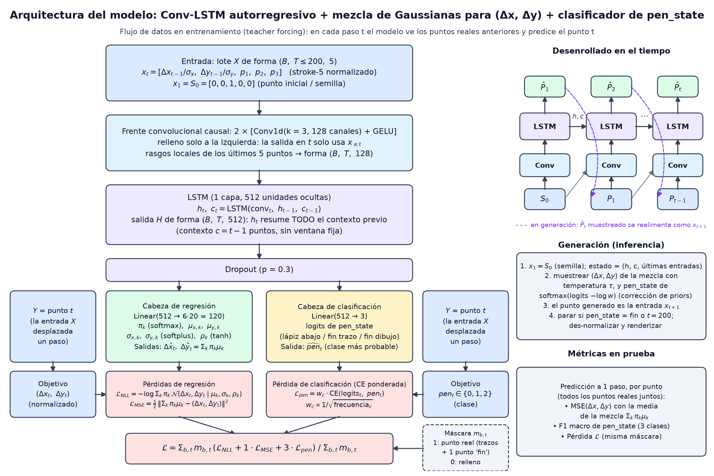

# Conv-LSTM fish — aporte de Juan Felipe Rodríguez

## Integrantes del equipo

Equipo 21:

1. Juan Javier Valera Mejias
2. Juan David Villalba Guavita
3. Juan Felipe Rodriguez Granados
4. Leidy Dayana Vega Medina

## Estado del aporte

El notebook fue ejecutado de principio a fin en CPU (portátil con
procesador i7 de 12.ª generación), sin errores. Las ejecuciones completas
que se hicieron dieron exactamente las mismas métricas.

Antes de fijar el modelo se compararon 39 configuraciones, cuyos
resultados están en la carpeta `experimentos/`. El conjunto de prueba
se usó una sola vez, al final, con el modelo elegido.

## Objetivo

Generar bocetos de la categoría fish de Quick, Draw! mediante un modelo
autorregresivo entrenado desde cero en PyTorch, que predice el siguiente
punto del lápiz: dos desplazamientos (regresión) y el estado del lápiz
(clasificación de tres clases).

## Datos y preprocesamiento

- Una única categoría: fish.
- Entrenamiento: 16.000 bocetos del conjunto train original.
- Validación: 2.000 bocetos del conjunto valid original.
- Prueba: 2.000 bocetos del conjunto test original.
- Selección aleatoria sin reemplazo, con semilla 42.
- Conversión de stroke-3 a stroke-5.
- Hasta 199 puntos y un punto de fin de dibujo por secuencia.
- Normalización de Δx y Δy con la desviación estándar de entrenamiento
  (51.57 y 35.50).
- Relleno hasta 200 posiciones, excluido mediante una máscara de la
  pérdida y de las métricas.
- Lotes agrupados por longitud para reducir el cómputo en CPU.

Ningún boceto necesitó truncado: la longitud máxima, incluyendo el punto
de fin, fue de 76 posiciones.

El estado del lápiz está desbalanceado:

| Estado | Frecuencia |
|---|---:|
| Lápiz abajo | 89.0 % |
| Fin de trazo | 8.3 % |
| Fin de dibujo | 2.6 % |

## Arquitectura

- Frente convolucional causal: 2 capas `Conv1d` con kernel 3, 128 canales
  y GELU. El relleno se aplica solo a la izquierda, de modo que cada
  posición ve únicamente los últimos 5 puntos.
- LSTM de una capa con 512 unidades.
- Dropout de 0.3.
- Cabeza `Linear(512, 120)`: mezcla de 20 Gaussianas bivariadas para
  (Δx, Δy) con pesos, medias, desviaciones y correlaciones.
- Cabeza `Linear(512, 3)`: logits del estado del lápiz.
- 1.429.243 parámetros entrenables.

La predicción puntual de (Δx, Δy), que se usa para el MSE, es la media
de la mezcla. Al generar se muestrea la mezcla completa.

Pérdida: NLL de la mezcla + 1 · MSE de su media + 3 · entropía cruzada
ponderada del estado del lápiz. Los pesos de clase son proporcionales a
1/√frecuencia (0.76, 2.48 y 4.43).

## Entrenamiento

| Hiperparámetro | Valor |
|---|---:|
| Optimizador | Adam |
| Tasa de aprendizaje | 0.002 |
| Tamaño del lote | 128 |
| Máximo de épocas | 60 |
| Paciencia de parada temprana | 8 épocas |
| Reducción de la tasa de aprendizaje | x0.5 tras 3 épocas sin mejora |
| Norma máxima para recorte de gradientes | 1.0 |
| Componentes de la mezcla | 20 |
| Peso del término MSE / de la entropía cruzada | 1 / 3 |

La mejor época fue la 48 y la parada temprana se activó en la época 56.
El entrenamiento tardó 41.4 minutos en CPU.

## Experimentos realizados

Las 39 configuraciones se evaluaron en validación, en tres rondas. Primero
se entrenaron muchas opciones durante 15 épocas y después solo las mejores
se entrenaron más tiempo.

Ronda 1 (13 corridas, 15 épocas): familias de modelo y forma de la salida.

| Modelo | Salida | Pérdida val | MSE val |
|---|---|---:|---:|
| LSTM-256 | MSE | n/c | 0.510 |
| LSTM-256 | Gaussiana | n/c | 0.701 |
| LSTM-256 | Mezcla de Gaussianas | 0.894 | 0.640 |
| LSTM-512 | Mezcla de Gaussianas | 0.748 | 0.567 |
| GRU-256 | Mezcla de Gaussianas | 0.914 | 0.649 |
| RNN simple-256 | Mezcla de Gaussianas | 0.920 | 0.612 |
| Transformer causal | Mezcla de Gaussianas | 0.780 | 0.656 |
| MLP con ventana c = 16 | Mezcla de Gaussianas | 0.852 | 0.634 |
| TCN causal | Mezcla de Gaussianas | 0.544 | 0.556 |

n/c: no comparable, porque esas variantes optimizan otra pérdida.

La cabeza MSE tiene el mejor MSE, pero al generar todos los bocetos son
la misma "U" promedio. La mezcla de Gaussianas fue la única que generó
bocetos variados. La TCN superó a la LSTM.

Ronda 2 (21 corridas, 15 épocas):

- Agregar un frente convolucional antes de la LSTM bajó la pérdida de
  0.894 a 0.603 con LSTM-256 y de 0.748 a 0.501 con LSTM-512, mejor que la
  TCN. Agregar la posición absoluta del lápiz no ayudó.
- Con contexto fijo, ver más puntos siempre mejoró los resultados: con el
  MLP, de 0.963 (c = 4) a 0.852 (c = 16); con la TCN, de 0.633 (campo
  receptivo 29) a 0.507 (253).
- Sobre Conv-LSTM-256: los pesos de clase subieron el F1 macro de 0.333 a
  0.610, el término MSE bajó el MSE de 0.578 a 0.500 y la combinación con
  w_pen = 3 fue la mejor (MSE 0.499, F1 0.636). La tasa de aprendizaje de
  0.002 bajó la NLL de 0.331 a 0.181.

Ronda 3 (5 corridas, hasta 60 épocas con parada temprana):

| Candidato | Pérdida val | Diferencia val − train | MSE val | F1 val |
|---|---:|---:|---:|---:|
| Conv-LSTM-512, dropout 0.1 | 1.613 | 0.132 | 0.450 | 0.662 |
| Conv-LSTM-512, dropout 0.3 | 1.507 | 0.141 | 0.445 | 0.667 |
| Conv-LSTM-512, dropout 0.1 + aumento ±15 % | 1.560 | 0.316 | 0.450 | 0.665 |
| Conv-LSTM-512, dropout 0.1, lr 0.001 | 1.503 | 0.262 | 0.445 | 0.670 |
| TCN-128 | 1.758 | 0.169 | 0.482 | 0.647 |

Con dropout 0.1 el modelo sobreajustó y la parada temprana lo detuvo en
la época 33. Dropout 0.3 y lr 0.001 quedaron prácticamente empatados; se
eligió dropout 0.3 porque su diferencia entre validación y entrenamiento
es casi la mitad y porque sus bocetos tienen un número de trazos más
parecido al de los reales.

## Resultados de la ejecución verificada

| Métrica | Resultado |
|---|---:|
| Mejor pérdida de validación | 1.5377 |
| MSE global de prueba, coordenadas normalizadas | 0.4560 |
| MSE global de prueba, en píxeles² | 882.46 |
| F1 macro de prueba, tres estados | 0.6702 |
| F1 macro de prueba con umbrales calibrados en validación | 0.6781 |
| Pérdida total de prueba | 1.5250 |

La evaluación de prueba utilizó 2.000 bocetos y 76.135 puntos reales,
incluyendo un punto de fin por boceto. Las métricas se agregaron
globalmente por punto, usando los puntos reales anteriores como contexto.

Como referencia, un modelo trivial que siempre predice Δ = 0 y "lápiz
abajo" obtiene un MSE de 0.993 y un F1 macro de 0.314.

Validación y prueba dieron resultados casi iguales: MSE de 0.448 y 0.456,
F1 de 0.670 en ambos.

## Limitaciones

El F1 por estado fue:

- Lápiz abajo: 0.9208.
- Fin de trazo: 0.4942.
- Fin de dibujo: 0.5956.

La principal debilidad es la detección del fin de trazo. El fin de dibujo
se detecta con un recall alto (0.92), pero con precisión moderada.

Las generaciones son reconocibles como peces, pero algunas tienen trazos
de más o contornos abiertos. Las métricas a un paso no miden directamente
la calidad de la generación autorregresiva.

La prueba de completar bocetos a partir del primer trazo real dio
resultados irregulares: en 3 o 4 de 8 casos el modelo agrega detalles
coherentes (ojo, boca o cola), pero en los demás los trazos nuevos quedan
desplazados o superpuestos. El modelo se entrenó para dibujar desde el
punto inicial y no para continuar un trazo dado.

Cada configuración se entrenó con una sola semilla y las rondas cortas
usaron 15 épocas, lo que puede perjudicar a modelos que convergen más
lento, como el Transformer.

## Archivos de esta versión

- MAPLN_Microproyecto_1_JuanFelipeRodriguez.ipynb
- diagrama_arquitectura.png
- boceto_generado_1.png
- boceto_generado_2.png
- boceto_generado_3.png
- modelo_convlstm_fish.pt: pesos del modelo final, con los
  hiperparámetros, la escala de normalización y el historial de
  entrenamiento.
- experimentos/: scripts y resultados de las 39 configuraciones
  (ver experimentos/README.md).

Los tres bocetos se generaron con temperatura 0.3 y semilla 2026. Tienen
35, 40 y 32 puntos, respectivamente. Se tomaron los tres primeros de 24
generados que el modelo terminó por sí mismo, con un número de puntos
dentro del rango intercuartílico de los bocetos reales y como máximo 4
trazos.

## Ejecución

1. Abrir el notebook en Jupyter, VS Code o Google Colab.
2. Ejecutar todas las celdas en orden desde el principio.

El notebook descarga el dataset público, entrena el modelo desde cero y
guarda los tres PNG y los pesos (`modelo_convlstm_fish.pt`) en la carpeta
de trabajo. Si hay GPU disponible la usa automáticamente; en CPU el
entrenamiento tarda alrededor de 40 minutos.

Para no esperar el entrenamiento, se puede poner `ENTRENAR = False` en la
celda de la sección 7.3. En ese caso el notebook carga
`modelo_convlstm_fish.pt` desde la carpeta del notebook o, si no está, lo
descarga de este repositorio, y las secciones 7.4, 8 y 9 dan los mismos
resultados que con el entrenamiento completo.

Dependencias: torch, numpy, pandas, matplotlib, scikit-learn.
